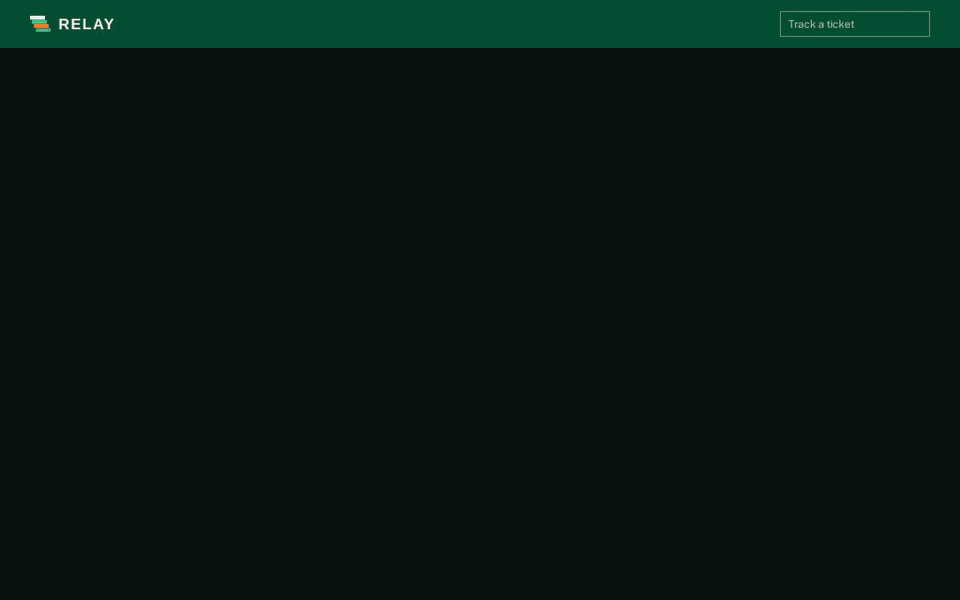

# Ticket-Pipeline

A support-ticket pipeline. A customer submits a ticket, a background worker triages it with an LLM and drafts a reply, and the customer watches it happen live. Staff get an ops console with live updates, alerts and replay for failures.

Built with Bun, Hono, PostgreSQL, Redis, AWS SQS, Socket.io and React.



## What it shows

- **LLMs in a real pipeline.** Two stages (triage, then draft), each returning schema-validated JSON, with timeouts, retries and a backup provider.
- **Async work done properly.** An SQS queue and a worker with per-stage retries, replay from the stage that failed, and escalation to ops when retries run out.
- **Observability.** Every provider call is recorded (outcome, latency, tokens) and summarised in the ops console.
- **Privacy by construction.** Public views, the ops feed and alerts are built field by field, and guard tests fail if anything else publishes to them.
- **Tests at every layer.** Vitest, Playwright end to end, and accessibility checks.

## Architecture

```
Customer / Ops (React app)
        │  HTTP + Socket.io
        ▼
Hono API (Bun) ──► PostgreSQL ◄──┐
        │                        │
        ▼                        │
   AWS SQS queue ──► Worker ─────┘
                       │
                       ▼
                 ai-service ──► llm-client ──► Portkey ──► primary LLM
                                                    └────► backup LLM (on failure)
```

1. `POST /api/tickets` stores the ticket as `queued` and sends a message to SQS.
2. The worker picks it up and runs **triage** (category, priority, sentiment, escalation, team), then **draft** (customer reply, internal note, next steps).
3. Each step and outcome is written to `ticket_events` and pushed live to the customer's page and the ops feed.
4. A stage that fails is retried up to 3 times. After that the ticket goes to `needs_attention`, ops is alerted, and staff can replay it.

## How the AI works

All model calls go through `src/lib/llm-client.ts`.

- **Structured output.** Each call forces a named function schema, and the result is validated with Zod (`TriageOutputSchema`, `DraftOutputSchema`). Malformed output is recorded as `invalid_response` and treated as a failure. It is one forced call per stage, not an agent loop.
- **Providers.** Requests go through the Portkey gateway to Google (Gemini, primary) and Groq (backup), set by `PRIMARY_GATEWAY` and `BACKUP_GATEWAY`. If the primary fails or times out (`AI_TIMEOUT_MS`, default 30s), the backup answers.
- **Recording.** Every call is written to `ai_interactions`, and a failed write never blocks the ticket. See [AI observability](docs/ai-observability.md).
- **No provider needed to try it.** `LLM_MODE=fake` returns canned output at the provider boundary. Everything above it (validation, retries, events) still runs. See [Testing without an AI provider](docs/web-app.md#testing-without-an-ai-provider).

## Quick start

**Needs:** Bun 1.3+, Node 20+ (Vitest only), Docker.

```bash
bun install
cp .env.example .env     # fill in the values below
docker compose up -d     # Postgres, Redis, LocalStack (SQS/SNS), Mailpit; creates the queues
bun run migrate
bun run dev              # API on http://localhost:3000
bun run worker           # in a second terminal
```

In `.env`, set `PORTKEY_API_KEY`, `GOOGLE_API_KEY` (primary, Gemini) and `BACKUP_API_KEY` (Groq). To skip providers entirely, set `LLM_MODE=fake`.

Try it:

```bash
curl -X POST http://localhost:3000/api/tickets \
  -H "Content-Type: application/json" \
  -d '{"subject": "Login not working", "description": "I cannot log in with my password"}'
# { "ticketId": "…", "referenceNumber": "TKT-001", "status": "queued", … }

curl http://localhost:3000/api/tickets/<ticketId>
```

For the web UI, run `bun run build` once and open http://localhost:3000, or run `bun run web:dev` for the Vite dev server on :5173. Staff sign in at `/ops` with `OPS_TOKEN` (`dev-ops-token` locally).

## Tests and checks

```bash
bun run test        # API, worker and repository tests (Vitest on Node)
bun run test:web    # web unit tests
bun run test:e2e    # Playwright against the built app (needs the Docker services up)
bun run lint        # ESLint
```

Use `bun run test`, not `bun test`: Vitest has to run on Node because `vi.mock` does not work under Bun. Stop any dev worker before `test:e2e`, since it reads the same queue.

## More detail

| Doc | Covers |
|---|---|
| [Web app](docs/web-app.md) | Pages, public vs ops views, ops console, fake LLM mode |
| [Ops](docs/ops.md) | Live feed, sign-in, email alerts, ticket recovery and replay |
| [Customer email](docs/customer-email.md) | Opt-in notifications and mail drivers |
| [Ticket history](docs/ticket-history.md) | Append-only event log and paging |
| [AI observability](docs/ai-observability.md) | `ai_interactions`, ops endpoints, example queries |
| [DESIGN.md](DESIGN.md), [PRODUCT.md](PRODUCT.md) | Design system and product intent |

## Project structure

```
src/
  index.ts, server.ts, app.ts   Entry points and the Hono app
  worker.ts                     Queue consumer: triage → draft → finish
  routes/ controllers/          HTTP layer
  services/                     Business logic, ops feed, alerts, notifications
  repositories/                 PostgreSQL access
  lib/                          llm-client, ai-service, queue, mailer, sessions, sockets
migrations/                     Database schema
tests/                          Vitest suite, including the privacy guard tests
web/                            React app (Vite, Tailwind, shadcn/ui), built to web/dist
e2e/                            Playwright tests
scripts/                        Migrations, infra setup, screenshots
```

## Deployment

The `Dockerfile` builds the web app and runs the API on `oven/bun`. The same image runs the worker with `docker run <image> bun src/worker.ts`. The target is Render's free tier.
